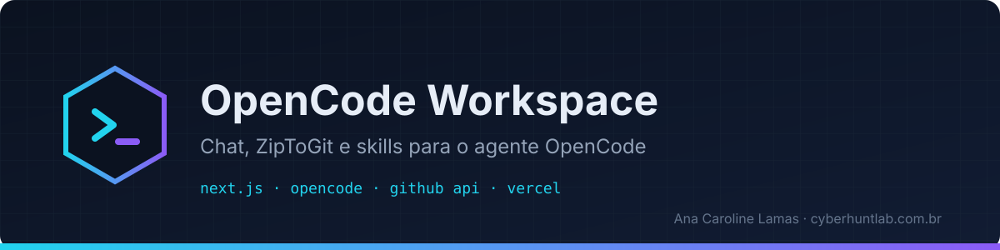

<p align="center"></p>

# OpenCode Workspace — chat, ZipToGit e skills para o OpenCode

Scaffold em **Next.js** de uma interface web para o agente de programação **OpenCode**, pensado para hospedar a interface no **Vercel** e manter o agente num servidor persistente. Ele reúne quatro áreas: **OpenCode Chat**, **ZipToGit** (publica o conteúdo de um ZIP num repositório GitHub), **Biblioteca de Skills** e **Configurações**. O agente roda no OpenCode oficial via `@opencode-ai/sdk`, e as chaves de provedores ficam no servidor OpenCode, nunca no navegador.

## Recursos

- **Chat com o OpenCode**: várias conversas, seletor de modelo, anexos e sessão do OpenCode associada a cada conversa. O histórico visual fica no `localStorage`.
- **ZipToGit** (`POST /api/github/publish`): importa os arquivos de um ZIP para um repositório e branch do GitHub usando a API Git Trees/Blobs, com ZIP de até 40 MB e arquivos de até 90 MB.
- **Biblioteca de Skills** (`GET /api/skills`): encontra pastas com `SKILL.md` em `OPENCODE_SKILLS_DIR` e `.agents/skills`, com busca.
- **Economia de tokens**: o `opencode.json` declara o plugin Dynamic Context Pruning (`@tarquinen/opencode-dcp`).
- **Diagnóstico**: `GET /api/health` informa se o servidor OpenCode está acessível.

## Instalação

Requisitos: **Node.js 20+**, npm e um servidor **OpenCode** em execução num host persistente (VM ou container).

```bash
git clone https://github.com/ticarollamas-arch/opencode-workspace-vercel.git
cd opencode-workspace-vercel
npm install
cp .env.example .env.local
```

| Variável | Uso |
|---|---|
| `OPENCODE_SERVER_URL` / `OPENCODE_SERVER_PASSWORD` | Servidor OpenCode persistente (padrão `http://127.0.0.1:4096`) |
| `GITHUB_TOKEN` | Token fine-grained com permissão *Contents: Read and write* |
| `OPENCODE_SKILLS_DIR` | Pasta de skills no executor (padrão `/workspace/.agents/skills`) |
| `APP_ACCESS_TOKEN` | Token da aplicação, se a autenticação estiver habilitada |
| `S3_*` | Armazenamento compatível com S3/R2 para uploads grandes (planejado) |

No host do executor, prepare as skills e o OpenCode:

```bash
bash scripts/bootstrap-executor.sh   # clona ticarollamas-arch/skills-main em .agents/skills
```

## Como usar

```bash
npm run dev      # http://localhost:3000
npm run lint     # tsc --noEmit
npm run build && npm start
```

### Rotas da API

| Método | Rota | Função |
|---|---|---|
| GET | `/api/health` | Estado do servidor OpenCode |
| POST / DELETE | `/api/chat` | Envia mensagem / encerra sessão |
| GET | `/api/skills` | Lista as skills disponíveis |
| POST | `/api/github/publish` | Publica um ZIP no GitHub |

### Deploy no Vercel

Importe o repositório; o `vercel.json` já define o framework e os comandos. Configure as variáveis em *Project Settings → Environment Variables*, com `OPENCODE_SERVER_URL` apontando para o servidor persistente. O Vercel hospeda a interface e as rotas curtas de controle, e as tarefas longas continuam no OpenCode.

## Limitações e próximos passos

Este é um scaffold de interface e rotas. Para produção, ainda são necessários:

- PostgreSQL para usuários, conversas, mapeamento de sessões e jobs;
- upload multipart direto para S3/R2 (arquivos grandes) com validação no executor;
- anexos multimodais ligados ao armazenamento;
- streaming de eventos por SSE/WebSocket;
- isolamento por usuário e auditoria das publicações no GitHub.

Os modelos listados no seletor dependem do catálogo do provedor configurado no OpenCode.

## Tecnologias

Next.js (App Router) · React · TypeScript · `@opencode-ai/sdk` · GitHub REST API (Git Trees/Blobs) · JSZip · lucide-react · Vercel

## Créditos

- [OpenCode](https://github.com/anomalyco/opencode): motor do agente, usado pelo SDK oficial.
- [opencode-dynamic-context-pruning](https://github.com/Tarquinen/opencode-dynamic-context-pruning): plugin declarado em `opencode.json`, licenciado sob AGPL-3.0. Mantenha-o como dependência separada.
- [skills-main](https://github.com/ticarollamas-arch/skills-main): biblioteca externa de skills, consumida preservando autoria e licença.

Mais detalhes em [UPSTREAMS.md](UPSTREAMS.md).

## Licença

Código deste repositório sob a licença MIT. Veja [LICENSE](LICENSE). Dependências de terceiros mantêm suas próprias licenças.
